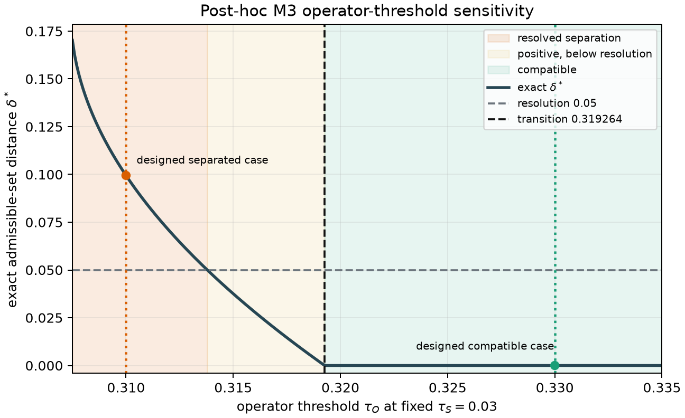
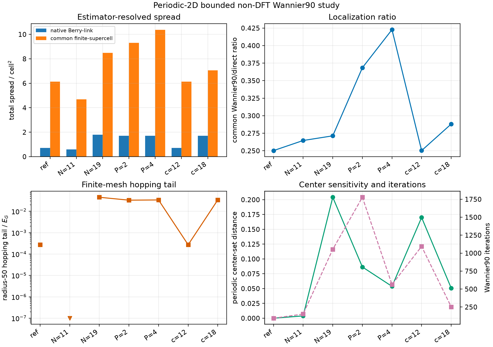

# Appendix A. Extracted Evidence Boundary

The numerical values reproduced in Sections III--V originate from the preserved
`docs/publications/papers/Ragasa2026a/v2/manuscript.tex` and its cited retained
calculations. This appendix
records their permitted role in Paper 3.

| Extracted component | Supported statement | Not supported |
|---|---|---|
| M2 rank-two alignment control | A known pointwise inverse attack is recoverable while one global unitary leaves a finite residual, and the attack changes finite-range compressibility | General alignment optimizer, continuum decay law, or material validity |
| M3 constrained rank-two admissible sets | One frozen finite alignment family has an explicit nonidentity-aligned common witness and, at a tighter operator threshold, a certified positive separation | Continuous or momentum-dependent alignment, higher-rank validity, material validity, or transferable thresholds |
| Rank-three smooth/rough frames | Finite-mesh equality of spectra and Wilson-phase multisets can coexist with different spread estimators and hopping tails | Continuum topology, material validity, or global localization optimum |
| Synthetic Wannier90 bridge | One algorithm-selected rank-three frame can be identified pointwise with the direct retained subspace while differing under a restricted global family | Mesh-independent MLWF convergence, global basin optimality, or first-principles validation |
| Procrustes construction | Pointwise and one-global unitary alignments solve different declared least-squares problems when their overlap factors are qualified | Permission to complete a rank-deficient map or enlarge the admissible family after observing results |

A post-hoc exact reanalysis of the sealed M3 training quadratics places the compatibility
transition at $\tau_H=0.3192641695$ for fixed $\tau_E=0.03$ and the declared nine-angle
family. It is sensitivity characterization, not a prospectively frozen prediction or
physical threshold calibration.

The sensitivity record is nonmonotone and reaches different localization basins. The
zero radius-50 tail for the $N=11$ case occurs because that finite translation inventory
is already fully retained; it is not evidence for a vanishing infinite-range tail.

No Paper 1 threshold, finite-angle inventory, mesh, tolerance, source identity, or
evidence identity is transferred into a future Paper 3 experiment. A new higher-rank
calculation requires its own protocol, schemas, verifier, convergence result, and
evidence qualification.
