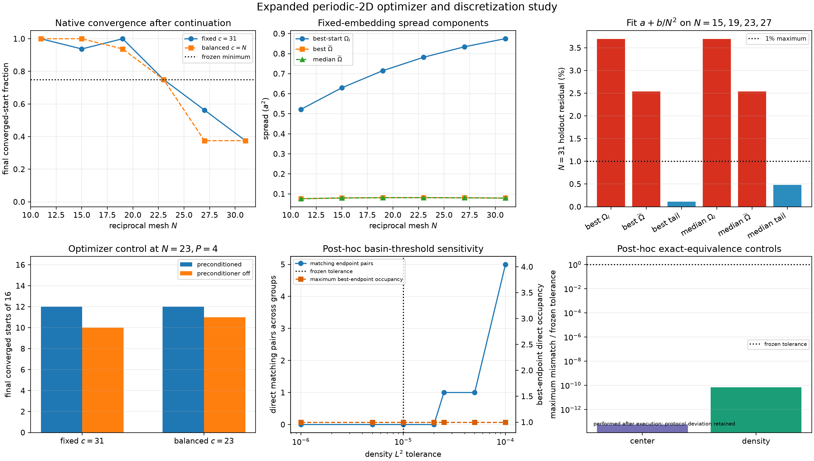

# Multiband gauge structure, aligned operators, and hopping locality

> <strong>Pre-results working manuscript.</strong> Red text
> identifies prospective work, open controls, unexecuted calculations, or conditional
> conclusions. The extracted finite calculations below retain their historical scope and
> are not results of the new higher-rank protocol.

## Abstract

A composite Bloch spectrum does not identify a unique retained frame or a unique
matrix-valued hopping representation. We formulate the multiband extension of the
band-equivalence/locality program in terms of retained projectors, periodic frames,
complex unitary gauge classes, explicitly admissible alignments, and complete
matrix-valued Fourier blocks. Retained rank-two controls establish the distinction
between pointwise and global alignment and then demonstrate common-witness and
certified-separation logic under a nonidentity constrained family. Historical rank-two
and rank-three calculations demonstrate finite-mesh gauge consistency alongside large
changes in spread and hopping tails, including converged algorithm-selected Wannier90
frames. A retained rank-three multistart follow-up additionally shows
that the declared Wannier90 mesh and basin-reproducibility criteria are not supported for
that synthetic rank-three interface. These controls motivate, but do not replace, a
higher-rank protocol with independent verification and separately
qualified projection, frame, conversion, and truncation channels.

## I. State spaces before multiband comparison

Let $P(\mathbf k)$ be a constant-rank spectral projector and let
$F(\mathbf k):\mathbb C^r\to\mathcal H_p$ be a periodic orthonormal frame satisfying
$F F^\dagger=P$. The retained matrix field is

$$
H_F(\mathbf k)=F^\dagger(\mathbf k)H_p(\mathbf k)F(\mathbf k).
$$

A second frame $F'(\mathbf k)=F(\mathbf k)G(\mathbf k)$ gives

$$
H_{F'}(\mathbf k)=G^\dagger(\mathbf k)H_F(\mathbf k)G(\mathbf k),
\qquad G(\mathbf k)\in U(r).
$$

The spectra and projectors are unchanged, while the represented matrices and hopping
blocks generally change. A different retained rank requires a separately justified
projection or embedding. Without a declared map between the spaces, an operator
subtraction is undefined rather than merely large.

Spectral projection, orbital projection, disentanglement, downfolding, frame selection,
and hopping truncation are distinct operations. In particular, an exact spectral
projector commutes with the parent, whereas an orbital-semantic projector generally does
not. The latter may require an energy-dependent Feshbach--Löwdin operator or a separately
qualified unitary decoupling.

## II. Pointwise and global unitary alignment

Given reference and candidate frames of equal rank, define the cross-overlap

$$
M(\mathbf k)=F_{\mathrm{cand}}^\dagger(\mathbf k)F_{\mathrm{ref}}(\mathbf k)
=L(\mathbf k)\Sigma(\mathbf k)V^\dagger(\mathbf k).
$$

When the declared pointwise alignment family is the complete unitary group, the polar
factor

$$
U(\mathbf k)=L(\mathbf k)V^\dagger(\mathbf k)
$$

minimizes the pointwise Frobenius frame residual. A one-global-unitary comparison instead
uses

$$
B=\sum_{\mathbf k}F_{\mathrm{cand}}^\dagger(\mathbf k)
F_{\mathrm{ref}}(\mathbf k)=L_B\Sigma_BV_B^\dagger,
\qquad U_{\mathrm{glob}}=L_BV_B^\dagger.
$$

These are different admissible alignment families, not two numerical approximations to
the same problem. A rank-deficient cross-overlap or aggregate leaves an undetermined
unitary action in null spaces. Equality at the declared singular-value cutoff is
therefore deficient and must fail closed unless a separately reviewed completion rule is
part of the protocol.

For momentum-dependent alignment, matrices are aligned before Fourier transformation:

$$
\widetilde H(\mathbf R)
=\frac{1}{N_k}\sum_{\mathbf k}e^{-i\mathbf k\cdot\mathbf R}
U^\dagger(\mathbf k)H(\mathbf k)U(\mathbf k).
$$

This mixes hopping ranges and requires periodicity and reciprocal-boundary sewing.
Wilson-loop and closure phases remain sewing diagnostics; they are not topological claims
without an independently qualified continuum construction.

### Extracted rank-two alignment control

A retained four-state synthetic parent supplies an isolated lowest-two-state group. A
known smooth periodic real rotation preserves the retained projector within
$3.24\times10^{-16}$ while producing maximum frame and represented-operator defects
$1.506$ and $0.997$ in the attacked frame. Pointwise Procrustes alignment recovers the
known inverse attack within $6.77\times10^{-16}$ and reduces the operator defect to
$9.83\times10^{-16}$. In contrast, the best one-global-unitary channel leaves maximum
frame and operator defects $1.131$ and $0.744$.

The attack also lengthens the matrix-hopping tail without changing any band energy. At
range eight, its omitted block norm and withheld maximum spectral error are
$5.65\times10^{-5}$ and $7.04\times10^{-5}$, compared with approximately
$1.6\times10^{-14}$ and $1.2\times10^{-14}$ after transport or pointwise recovery.
These values establish a finite controlled alignment/locality mechanism, not a general
optimizer or continuum decay law.

## III. Admissible sets and bounded decisions

Let $X$ be a declared model-parameter domain with metric $d$, and let
$L_E(\boldsymbol\theta)$ and $L_{H,\mathrm{orb}}(\boldsymbol\theta)$ be frozen spectral
and aligned-operator losses. The latter minimizes only over the declared admissible
alignment family. For fixed thresholds, define

$$
\begin{aligned}
\mathcal A_E&=\{\boldsymbol\theta\in X:L_E(\boldsymbol\theta)\le\tau_E\},\\
\mathcal A_H&=\{\boldsymbol\theta\in X:L_{H,\mathrm{orb}}(\boldsymbol\theta)\le\tau_H\},\\
\delta^*&=\inf_{\boldsymbol\theta_E\in\mathcal A_E,
\boldsymbol\theta_H\in\mathcal A_H}
 d(\boldsymbol\theta_E,\boldsymbol\theta_H).
\end{aligned}
$$

**Proposition (witnesses and certified separation).** For nonempty
$\mathcal A_E$ and $\mathcal A_H$, a common witness in their intersection proves
$\delta^*=0$. Every feasible pair supplies an upper bound on $\delta^*$. A certified
bound $0<\underline\delta\le\delta^*$ proves that the sets are disjoint. Failure of a
search or local optimizer to find a common witness proves none of these statements. If
both sets are compact and disjoint, their distance is attained and strictly positive;
without compactness, disjoint nonempty sets can have zero distance.

*Proof.* A common witness supplies a feasible equal pair of distance zero. Any other
feasible pair bounds the defining infimum from above, while a positive certified lower
bound excludes an intersection. If both sets are compact, their Cartesian product is
compact and the continuous distance function attains its minimum. A zero attained
minimum would identify a common point, so disjointness makes that minimum positive. A
failed search supplies neither a witness nor a lower bound. $\square$

If either set is empty, the corresponding single-criterion feasibility test fails; no
finite set-to-set distance is reported in its place. The proposition is general decision
bookkeeping, not a claim that an arbitrary nonconvex separation has been computed.

### Controlled rank-two common-witness precursor

The retained M3 calculation from the earlier rank-two study
[[1](#ref-ragasa2026a)] starts from a transported rank-two reference $H(k)$ and uses the
candidate below. Here $E_{\mathrm{ref}}>0$ is an arbitrary
reference-energy normalization, not a band gap:

$$
H_{s,\lambda}(k)=\overline E(k)I+sE_{\mathrm{ref}}I
+\lambda\left[H(k)-\overline E(k)I\right],
\qquad (s,\lambda)\in[-0.25,0.25]\times[0.4,1.2].
$$

Its operator comparison minimizes over a prospectively frozen family of nine constant
real rotations with angles from $-1.2$ to $1.2$ radians. It excludes the
momentum-dependent pointwise alignment that recovers the constructed frame attack.

With $\tau_E=0.03$ and $\tau_H=0.33$, the original candidate $(s,\lambda)=(0,1)$
passes both requirements using the nonidentity constant alignment $\phi=0.3$:

$$
L_E(0,1)=7.59\times10^{-16},
\qquad
L_H(0,1;\phi=0.3)=0.3286318914.
$$

This retained point is the common witness in the left panel below; compatibility does
not follow merely from visual boundary overlap.

Keeping $\tau_E=0.03$ but tightening the operator threshold to $\tau_H=0.31$ moves the
closest spectral and operator boundary points to splitting scales $0.9354687052$ and
$0.8360013041$. The analytic quadratic certificate gives

$$
\delta^*=0.0994674010>0.05,
$$

where $0.05$ is the frozen separation resolution.

At the compatible threshold, the nonidentity $0.3$-radian constant alignment admits the
explicit common witness (left). Tightening only the operator threshold produces
certified separation within the same frozen nine-angle family (right). The panels do not
compare an unrestricted pointwise alignment with no alignment.

This precursor directly exercises a constrained multiband alignment family, but only a
finite one. It establishes neither a continuous or momentum-dependent optimizer nor a
higher-rank result or transferable physical thresholds. Its role is to demonstrate the
common-witness and certified-separation decisions before the higher-rank alignment
families below introduce additional feasibility and conditioning questions.

## IV. Extracted rank-three two-dimensional evidence

A retained two-dimensional calculation compared a smooth projected frame with a periodic
rough internal gauge for the lowest three bands. The two frames agreed spectrally within
$1.22\times10^{-15}E_{\mathrm{ref}}$ and in unordered discrete Wilson-loop eigenphases within
$2.22\times10^{-15}$. The finite-mesh winding diagnostic was zero in both frames.
Nevertheless, their common finite-supercell spread estimators were $24.90a^2$ and
$67.70a^2$, while the omitted hopping norms beyond squared-radius shell 18 were
$1.38\times10^{-2}E_{\mathrm{ref}}$ and $5.25\times10^{-1}E_{\mathrm{ref}}$.

These values establish a finite rank-three gauge/locality control. They do not certify a
continuum Chern invariant, a global localization optimum, or a material Hamiltonian.

## V. Algorithm-selected Wannier90 frames

Wannier90 constructs maximally localized Wannier representations from Bloch-state input
using a discrete reciprocal-space localization procedure [[7](#ref-mostofi2008),
[8](#ref-pizzi2020)]. Here it is an external localization engine: the present work does
not reimplement its spread optimizer or identify optimizer convergence with physical
model validation.

### Comparator hierarchy

Let $F_D(\mathbf k)$ be a direct projected frame and let $F_W(\mathbf k)$ be a
Wannier90-selected frame of the same declared rank. Their represented projectors and
Hamiltonians are

$$
P_X(\mathbf k)=F_X(\mathbf k)F_X^\dagger(\mathbf k),
\qquad
H_X(\mathbf k)=F_X^\dagger(\mathbf k)H_p(\mathbf k)F_X(\mathbf k),
\qquad X\in\{D,W\}.
$$

Projector agreement, pointwise identification, and restricted global identification are
separate tests. When
$M_{WD}(\mathbf k)=F_W^\dagger(\mathbf k)F_D(\mathbf k)$ is full rank, its polar factor
$U_{WD}(\mathbf k)$ defines the pointwise comparison
$U_{WD}^\dagger H_WU_{WD}-H_D$. A smaller admissible family may allow integer orbital
translations

$$
D_{\mathbf m}(\mathbf k)=\operatorname{diag}
\left(e^{-i\mathbf k\cdot\mathbf m_1},\ldots,
      e^{-i\mathbf k\cdot\mathbf m_r}\right)
$$

followed by one constant unitary. Failure of that restricted family to reproduce the
pointwise result is an alignment-family statement, not a loss of abstract unitary
equivalence.

Native Wannier90 Berry-link spread, a common finite-supercell spread estimator, and a
complete-block hopping tail are also distinct quantities. Only values reconstructed
with the same estimator, mesh, lattice metric, and support may be compared directly.
Wannier90 convergence establishes termination under its declared native criterion; it
does not establish a unique basin, mesh convergence, or global MLWF optimality.

### Retained one-dimensional rank-two precursor

A synthetic 128-point interface supplied Wannier90 3.1.0 with two isolated rank-two band
groups. Its source normalization $E_G$ is relabeled $E_{\mathrm{ref}}$ here and is not a
physical band gap. Initial runs did not satisfy the frozen spread criterion. Fresh runs adding only
the documented preconditioner converged after 69 iterations for the lower pair and 4176
iterations for the upper pair. Pointwise identification left maximum represented-
operator defects $1.13\times10^{-10}E_{\mathrm{ref}}$ and
$4.86\times10^{-10}E_{\mathrm{ref}}$, respectively. At range 12, their omitted-block
norms were $2.53\times10^{-4}E_{\mathrm{ref}}$ and
$6.33\times10^{-3}E_{\mathrm{ref}}$, with training spectral truncation errors
$9.32\times10^{-4}E_{\mathrm{ref}}$ and $3.09\times10^{-2}E_{\mathrm{ref}}$.

This precursor demonstrates a bounded interface, convergence rescue, and pointwise
frame comparison for two finite rank-two groups. It does not establish multistart basin
reproducibility, higher-rank behavior, or transferability of the preconditioner.

### Extracted rank-three two-dimensional bridge

A separate synthetic two-dimensional calculation used Wannier90 3.1.0 on a
$15\times15\times1$ mesh with three trial projections and no disentanglement. The direct
projected and Wannier90-selected frames had maximum projector discrepancy
$2.65\times10^{-10}$. Pointwise identification reduced their represented-operator
discrepancy to $3.57\times10^{-10}E_{\mathrm{ref}}$. A bounded family allowing integer orbital
translations in $[-1,1]^2$ followed by one constant orbital unitary instead left an
operator discrepancy of $1.490E_{\mathrm{ref}}$.

Under one common finite-supercell estimator, the Wannier90 and direct-frame spreads were
$6.1359a^2$ and $24.5163a^2$. At squared radius 50, their omitted hopping norms were
$2.72\times10^{-4}E_{\mathrm{ref}}$ and $5.90\times10^{-3}E_{\mathrm{ref}}$. A retained six-case mesh, cutoff, and
embedding study was nonmonotone and reached different localization basins. The evidence
therefore supports one finite algorithm-selected comparison, not mesh-independent
localization or global MLWF optimality.

The one-dimensional and two-dimensional calculations are algorithm-selected historical
controls, not executions of the analytic higher-rank protocol below. The full
rank-three sensitivity record is retained in
[Appendix A](appendices/A-1-extracted-evidence-boundary.md) rather than interpreted as a
convergence sequence.

## VI. Extracted optimizer-basin follow-up

A subsequent study held the synthetic rank-three parent fixed while varying reciprocal
mesh, plane-wave cutoff, inactive third-direction embedding, deterministic initial
$U(3)$ frame, and preconditioner status. Fourteen distinct interfaces received sixteen
starts, with two matched interfaces repeated without preconditioning. Of 256 initial
localizations, 136 met the native Wannier90 criterion. The other 120 were continued once
from their exact checkpoints; 60 were rescued and 60 remained nonconverged, giving 196
converged final endpoints.

At fixed inactive length and cutoff, convergence fell from 9 of 16 starts at $N=27$ to 6
of 16 at $N=31$. Across that pair, the best observed invariant spread component changed
by 4.66% and the gauge-dependent component by 1.62%. The finest cutoff pair stabilized
its declared scalar, center, tail, and convergence-fraction diagnostics, but every
observed density- and $D_4$-aware basin remained a singleton; the required repeated-best-
basin condition failed in every group. The frozen combined convergence criteria were
therefore not supported.

| Frozen channel | Retained outcome | Disposition |
|---|---:|---|
| Initial native convergence | 136/256 | incomplete |
| Checkpoint continuations | 60/120 rescued | 60 final nonconvergences retained |
| Final native convergence | 196/256 | bounded coverage, not complete convergence |
| Finest fixed-mesh pair | 9/16 to 6/16 converged starts | convergence-fraction failure |
| Finest cutoff pair | scalar, center, tail, and fraction gates pass | repeated-best-basin gate still fails |
| Best observed basin occupancy | 1 in every group | reproducibility criterion fails |

This is a controlled negative result for one synthetic interface and one finite protocol.
The basin labels classify observed endpoints; they do not prove that every endpoint is a
mathematically distinct local minimum, that Wannier90 generally fails, or that any
material Hamiltonian has the same sensitivity. A missed pre-execution classifier-control
record remains a disclosed protocol deviation; post-hoc roundoff controls do not erase
it.

## VII. Dimension-indexed arbitrary-rank synthetic family

The proposed higher-rank control is a family indexed independently by spatial dimension
$d\in\{1,2,3\}$, retained rank $r\geq3$, and finite gauge-circuit depth $L\geq1$.
"Arbitrary rank" means that the mathematical definition has no rank-specific formula;
every calculation still uses one declared finite $r$. It does not mean an
infinite-dimensional calculation or a rank-independent computational cost.

### Common isolated parent

Let the Brillouin torus be $\mathbb T^d=[-\pi,\pi)^d$ and let
$E_r:\mathbb C^r\to\mathbb C^{2r}$ embed the retained coordinates into the first $r$
ambient coordinates. Define

$$
P_0=E_rE_r^\dagger,
\qquad
D_r(\mathbf k)=\operatorname{diag}(\epsilon_1(\mathbf k),\ldots,
\epsilon_r(\mathbf k)),
$$

and an exterior block

$$
D_{\mathrm{ext}}(\mathbf k)=\operatorname{diag}
(\epsilon^{\mathrm{ext}}_1(\mathbf k),\ldots,
\epsilon^{\mathrm{ext}}_r(\mathbf k)).
$$

The real-valued periodic dispersions must satisfy the prospectively declared uniform
exterior-isolation condition

$$
\Delta_{\mathrm{iso}}=\inf_{\mathbf k\in\mathbb T^d}
\left[
\min_b\epsilon_b^{\mathrm{ext}}(\mathbf k)
-\max_a\epsilon_a(\mathbf k)
\right]>0.
$$

Here $E_{\mathrm{ref}}$ is the common positive energy scale, while $E_g$ remains
reserved for a physical valence--conduction band gap.

For $a=1,\ldots,r$, let

$$
K_a=|r+a\rangle\langle a|-|a\rangle\langle r+a|
$$

be an anti-Hermitian retained--exterior pair generator. With real periodic mixing fields
$\eta_a(\mathbf k)$, define

$$
W_r(\mathbf k)=\prod_{a=1}^{r}\exp\!\left[
\eta_a(\mathbf k)K_a\right],
\qquad
F_r(\mathbf k)=W_r(\mathbf k)E_r.
$$

The generators act on disjoint coordinate pairs, so their factors commute. The parent,
retained projector, and smooth represented Hamiltonian are

$$
H_p^{(d,r)}(\mathbf k)=W_r(\mathbf k)
\begin{pmatrix}
D_r(\mathbf k)&0\\
0&D_{\mathrm{ext}}(\mathbf k)
\end{pmatrix}
W_r^\dagger(\mathbf k),
\qquad
P_r(\mathbf k)=F_r(\mathbf k)F_r^\dagger(\mathbf k),
$$

$$
H_{F_r}(\mathbf k)=F_r^\dagger H_p^{(d,r)}F_r=D_r(\mathbf k).
$$

Setting every $\eta_a$ to zero gives a constant-projector gauge-only control. Nonzero
mixing fields give a known moving projector without changing the exact exterior gap.
These are different controls and must not be merged into one error channel.

### Layered real or complex internal gauge

For adjacent retained coordinates $j$ and $j+1$, embed the complex Givens block

$$
R_{j,j+1}(\theta,\phi)=
\begin{pmatrix}
\cos\theta&-e^{-i\phi}\sin\theta\\
e^{i\phi}\sin\theta&\cos\theta
\end{pmatrix}_{j,j+1}
$$

in $U(r)$. Layer $\ell$ contains the disjoint neighbor pairs

$$
\mathcal P_\ell=
\left\{(j,j+1):1\leq j<r,\ j\equiv\ell\pmod 2\right\}.
$$

With increasing layer order declared as part of the model and with
$Q_r(\mathbf k)=\operatorname{diag}(e^{i\chi_1(\mathbf k)},\ldots,
e^{i\chi_r(\mathbf k)})$, define

$$
G_{r,L}(\mathbf k)=Q_r(\mathbf k)
\prod_{\ell=1}^{L}
\prod_{(j,j+1)\in\mathcal P_\ell}
R_{j,j+1}\!\left(
\theta_{\ell j}(\mathbf k),\phi_{\ell j}(\mathbf k)
\right).
$$

Factors within one layer commute; neighboring layers generally do not. Thus the family
is non-Abelian without being a direct sum of independent rank-two problems. The real
specialization $\phi_{\ell j}=\chi_a=0$ lies in $SO(r)$. Allowing complex phases gives a
$U(r)$ family. These two gauge classes require separate protocol cases.

The attacked frame and represented operator are

$$
F'_{r,L}(\mathbf k)=F_r(\mathbf k)G_{r,L}(\mathbf k),
\qquad
H'_{r,L}(\mathbf k)=G_{r,L}^\dagger(\mathbf k)
D_r(\mathbf k)G_{r,L}(\mathbf k).
$$

At every $\mathbf k$,

$$
F'_{r,L}F_{r,L}^{\prime\dagger}=P_r,
\qquad
\operatorname{spec}H'_{r,L}=\operatorname{spec}D_r.
$$

These are analytic identities of the model, not numerical findings. The gauge can still
change matrix-valued Fourier support and the consequences of subsequent truncation.

### One-dimensional specialization

For $d=1$, $k\in[-\pi,\pi)$ and every scalar field above is a finite trigonometric
series

$$
f^{(1)}(k)=c_0+\sum_{n\in\mathcal Q_1}
\left[a_n\sin(nk)+b_n\cos(nk)\right],
\qquad \mathcal Q_1\subset\mathbb N.
$$

The selected first development tranche uses $\mathcal Q_1=\{1,2\}$, the constant
projector P0, and the real gauge class G0. For

$$
x_{r,a}=\frac{2a-r-1}{r-1},
\qquad
c(k)=\frac34\cos k+\frac14\cos(2k),
$$

the retained and exterior dispersions are

$$
\frac{\epsilon_a(k)}{E_{\mathrm{ref}}}
=0.40x_{r,a}+0.25(1+0.20x_{r,a})c(k),
$$

$$
\frac{\epsilon_a^{\mathrm{ext}}(k)}{E_{\mathrm{ref}}}
=3.00+0.30x_{r,a}+0.10c(k).
$$

At fixed $k$, the retained maximum and exterior minimum occur at $x_{r,a}=1$ and
$x_{r,a}=-1$, respectively. Their separation is
$(2.30-0.20c(k))E_{\mathrm{ref}}$. Since $c(k)\leq1$ and $c(0)=1$, every selected rank
has the exact mesh-independent exterior-isolation energy
$\Delta_{\mathrm{iso}}=2.10E_{\mathrm{ref}}$; [Appendix
B](appendices/A-2-d1-p0-g0-isolation-gap-certificate.md) gives the analytic gap and
angle certificates and the finite-grid sanity check. With

$$
y_{r,j}=\frac{2j-r}{r-1},
\qquad
s_\ell(k)=\frac34\sin k+\frac14(-1)^\ell\sin(2k),
$$

the deterministic real attack uses

$$
\theta_{\ell j}(k)=0.35(-1)^{\ell+j}
(1+0.15y_{r,j})s_\ell(k).
$$

Writing $q=(\sqrt{41}-3)/8$ and
$s_*=\sqrt{1-q^2}(3/4+q/2)$, its exact rank-$r$ continuum maximum is

$$
\max_{k,\ell,j}|\theta_{\ell j}(k)|
=0.35\left[1+0.15\frac{r-2}{r-1}\right]s_*<0.4025\ \mathrm{rad}.
$$

The selected ladder is
$r\in\{3,4,8,16\}$ and $L\in\{1,2,4,8\}$. Its shared later-dimensional subset is
$r\in\{3,4,8\}$ and $L\in\{1,2,4\}$. Identity, one-global-unitary,
pointwise-complete-unitary, and known-inverse-oracle channels remain separate; the
oracle is not a fitted recovery.

**Proposition (exact D1 representation certificates).** Under the continuum Fourier
convention above, the smooth represented field $D_r(k)$ has
$T_{D_r}(R)=0$ for every $|R|>2$. For P0, the exact candidate-to-reference overlap is
$M(k)=G_{r,L}^\dagger(k)$, all its singular values equal one, and its unique
complete-unitary pointwise polar factor is $G_{r,L}^\dagger(k)=G_{r,L}^{-1}(k)$.
Consequently A2 and A3 both restore $D_r(k)$ before Fourier transformation in exact
arithmetic. Every attacked or aligned field remains periodic and Hermitian, so its
Fourier blocks satisfy $T(-R)=T(R)^\dagger$.

*Proof.* Each entry of $D_r(k)$ contains only a constant, $\cos k$, and $\cos(2k)$,
which proves the support statement. Since $F'_{r,L}=F_rG_{r,L}$ and
$F_r^\dagger F_r=I_r$, their cross-overlap is $G_{r,L}^\dagger$. This matrix is unitary,
so every singular value is one and its polar factor is itself. Substitution into
$U^\dagger H'_{r,L}U$ with $U=G_{r,L}^\dagger$ gives $D_r$. Periodicity and Hermiticity
then give the standard Fourier pairing. $\square$

This proposition distinguishes analytic identities from later numerical diagnostics.
A2 reconstructs a polar factor from sampled frames, whereas A3 receives the generating
inverse; agreement tests implementation and conventions rather than practical recovery.
There is no analogous guarantee for A1. Moreover, the nonlinear entries
$\sin\theta_{\ell j}(k)$ and $\cos\theta_{\ell j}(k)$ mean that the attacked field is not
assigned a finite hopping support merely because the input angles use two harmonics.

The model has one primitive reciprocal cycle, one endpoint-sewing condition, and hopping
blocks indexed by $R\in\mathbb Z$. The complete pre-execution D1 v1 protocol uses odd
construction meshes $M\in\{513,1025,2049\}$, a disjoint shifted 8191-point evaluation
mesh, and supports $|R|\leq S$ for
$S\in\{0,1,2,4,8,16,32,64,128\}$. It freezes singular-value and numerical tolerances,
refinement and effect-resolution rules, strict schema identities, a direct-formula
verifier, resource ceilings, and retained-evidence policy before execution. No
implementation or calculation of this tranche is reported here.

### Two-dimensional specialization

For $d=2$, $\mathbf k=(k_x,k_y)$ and

$$
f^{(2)}(\mathbf k)=c_0+
\sum_{\mathbf q\in\mathcal Q_2}
\left[a_{\mathbf q}\sin(\mathbf q\cdot\mathbf k)
+b_{\mathbf q}\cos(\mathbf q\cdot\mathbf k)\right].
$$

A dimension-coupled candidate inventory is

$$
\mathcal Q_2=\{(1,0),(0,1),(1,1),(1,-1)\}.
$$

At least one mixed harmonic must have a nonzero coefficient in a genuinely
nonseparable case. The model requires sewing across both pairs of reciprocal faces,
closures along both primitive cycles, $xy$ plaquettes, and hopping blocks indexed by
$\mathbf R\in\mathbb Z^2$. The existing fixed rank-three attack is the $r=3$ precursor
of this adjacent-rotation construction, not evidence for arbitrary rank.

### Three-dimensional specialization

For $d=3$, $\mathbf k=(k_x,k_y,k_z)$ with the same finite Fourier form and a candidate
inventory

$$
\begin{aligned}
\mathcal Q_3=\{&(1,0,0),(0,1,0),(0,0,1),
(1,1,0),(0,1,1),(1,0,1),(1,1,1)\}.
\end{aligned}
$$

Nonzero mixed coefficients prevent the construction from reducing to three independent
one-dimensional problems. Qualification requires sewing across all three reciprocal-face
pairs, closures along the $x$, $y$, and $z$ cycles, $xy$, $xz$, and $yz$ plaquettes,
and matrix-valued hopping blocks indexed by $\mathbf R\in\mathbb Z^3$. Tensor-mesh work
scales at least as $N_xN_yN_z$ and dense unitary factorizations as $r^3$ per sampled
point, so three-dimensional evaluation must use bounded ranks and streamed diagnostics.

### Fourier and truncation statement

For any of the three dimensions, the continuum hopping block associated with a declared
periodic represented field is

$$
T(\mathbf R)=\frac{1}{(2\pi)^d}
\int_{\mathbb T^d}e^{-i\mathbf k\cdot\mathbf R}
H(\mathbf k)\,d^d\mathbf k,
\qquad \mathbf R\in\mathbb Z^d.
$$

A finite calculation replaces this integral by a declared tensor-mesh transform and
must report conversion and aliasing consequences separately. Every retained truncation
support must contain complete inversion pairs and complete orbits of whatever point
group the protocol actually declares. No point-group, time-reversal, or topological
symmetry is implicit in the generic coefficient family.

Because $F_r(\mathbf k)$ is supplied as a global periodic frame, this initial family is
a topologically trivial composite bundle by construction. Wilson loops, closures, and
plaquettes are therefore transport and sewing diagnostics here, not evidence for a
three-dimensional topological classification. A topologically obstructed family would
be a separate model and protocol.

## VIII. Prospective multiband protocol

The dimension-indexed family above remains prospective outside D1. Its first bounded
P0/G0 specialization now has the reserved version identity
`ksdft2effmass.campaign.periodic-reduction.periodic1d.higher-rank-composite-band-alignment-and-locality.v1`.
The protocol fixes the parent, exact certificates, real Givens-angle law, rank/depth
ladder, A0--A3 channels, cross-rank normalizations, meshes, supports, singular-value and
numerical tolerances, convergence gates, effect-resolution thresholds, strict schema
identities, direct-formula verifier, resource gate, and evidence package. It remains a
pre-execution candidate until implementation, schemas, and verifier pass review.
Moving-projector, complex-gauge, restricted-circuit, and multidimensional cases remain
separate open protocols. Rank-two formulas and the multidimensional controls of the
preceding study [[2](#ref-ragasa2026b)] will not be inherited without a reviewed
specialization.

The maintained experiment inventory is therefore:

| Experiment surface | Current status | Role in this paper |
|---|---|---|
| periodic-1D composite-band alignment/locality | migration in progress; prospective protocol; no maintained run | publication-independent rank-two successor to the historical M2/M3 controls |
| periodic-1D higher-rank composite-band alignment/locality D1 P0/G0 | complete pre-execution v1 protocol candidate; no implementation or run | selected future rank/depth experiment |
| Wannier90 localization reproducibility | no maintained experiment package yet | historical calculation evidence only; future separate family |

Consequently, the experiment tree currently contributes a retained owner boundary and
complete prospective controls, but no new Paper 3 execution evidence.

The evidence ledger keeps exact analytic certificates, sampled diagnostics, parent
construction, projection or embedding, frame construction, covariant equivalence,
restricted alignment, Fourier conversion, interpolation, deliberate truncation, and
total Hamiltonian and spectral consequences separate. Rank and circuit depth are
independent finite variables. No combined diagnostic score or asymptotic arbitrary-rank
claim is admitted.

## IX. Results boundary

No calculation has yet instantiated this arbitrary-rank family. The D1 v1 identity and
complete protocol controls are reserved, but no reviewed implementation, immutable
executed version, D1 v1 numerical result, retained D1 run, or D1 evidence package exists.
New numerical conclusions for that protocol may be added only after implementation review,
authorized execution, and independent verification. The extracted rank-three controls
above retain their original
finite-mesh and synthetic scope. The non-SOC bulk-silicon reduction, common-space defect
construction, obstruction study, and SOC dopant application remain separate unpublished
works [[3](#ref-ragasa2026d)--[6](#ref-ragasa2026g)].

## References

1. E. J. M. Ragasa, “Band Equivalence Does Not
   Determine Hopping Locality: Exact Rank-Two Geometry and Equal-Accuracy Range
   Inflation,” unpublished manuscript (2026).
2. E. J. M. Ragasa, “From Spectral Hamiltonians to Tight
   Binding in Two and Three Dimensions: Isotropic Locality on Orthogonal and
   Non-Orthogonal Lattices,” unpublished manuscript (2026).
3. E. J. M. Ragasa, “Compatibility of Spectral and
   Operator Reductions of a First-Principles Silicon Hamiltonian,” unpublished
   manuscript (2026).
4. E. J. M. Ragasa, “Common-Space Construction of
   Periodic Defect Operators,” unpublished pre-results manuscript (2026).
5. E. J. M. Ragasa, “Topological and Symmetry
   Obstructions to Multiband Operator Alignment,” unpublished pre-results manuscript
   (2026).
6. E. J. M. Ragasa, “Spin–Orbit-Coupled Impurity
   Operators for Substitutional Phosphorus and Boron in Silicon,” unpublished pre-results
   manuscript (2026).
7. A. A. Mostofi, J. R. Yates, Y.-S. Lee, I. Souza,
   D. Vanderbilt, and N. Marzari, “wannier90: A Tool for Obtaining
   Maximally-Localised Wannier Functions,” *Computer Physics Communications* **178**,
   685–699 (2008), doi:10.1016/j.cpc.2007.11.016.
8. G. Pizzi *et al.*, “Wannier90 as a Community Code:
   New Features and Applications,” *Journal of Physics: Condensed Matter* **32**, 165902
   (2020), doi:10.1088/1361-648X/ab51ff.
